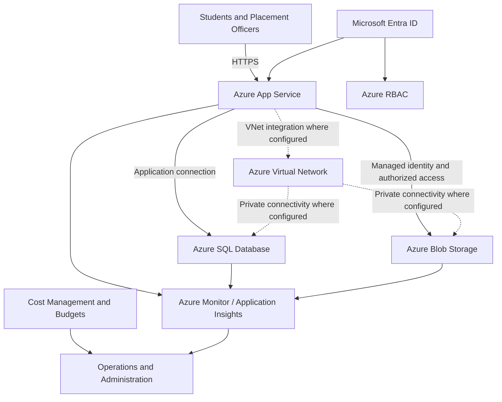

# Architecture Design

## Proposed logical architecture



## Component responsibilities

| Component | Responsibility |
|---|---|
| Azure App Service | Hosts the web application and API |
| Azure SQL Database | Stores structured application records |
| Azure Blob Storage | Stores documents and other unstructured files |
| Microsoft Entra ID | Identity and authentication |
| Azure RBAC | Azure resource authorization |
| Managed identity | Workload identity for supported service access |
| VNet integration/private endpoints | Private network connectivity where configured |
| NSGs | Filter traffic on supported network interfaces/subnets |
| Azure Monitor | Metrics, logs, alerts and observability |
| Cost Management | Cost analysis and budgets |

## Illustrative resource organisation

```text
Subscription
└── StudentPlacement-RG
    ├── placement-app-prod
    ├── placement-storage-prod
    ├── placement-sql-prod
    ├── placement-vnet-prod
    └── placement-logs-prod
```

These are proposed example names. Actual Azure naming rules and uniqueness requirements apply.

## Network design considerations
- Public users access the portal over HTTPS.
- Decide whether the App Service public endpoint is appropriate or whether a gateway/private access pattern is required.
- Configure App Service VNet integration if the application needs outbound access to resources in a VNet.
- Use private endpoints for supported services when private access is required.
- Configure private DNS zones and name resolution for private endpoints.
- Apply NSGs only where supported and appropriate.
- Do not assume a VNet or NSG automatically secures every managed Azure service.

## Availability and resilience
Choose region, availability and backup options based on business requirements, service support, recovery objectives and budget. Validate the selected service's regional capabilities before deployment.
